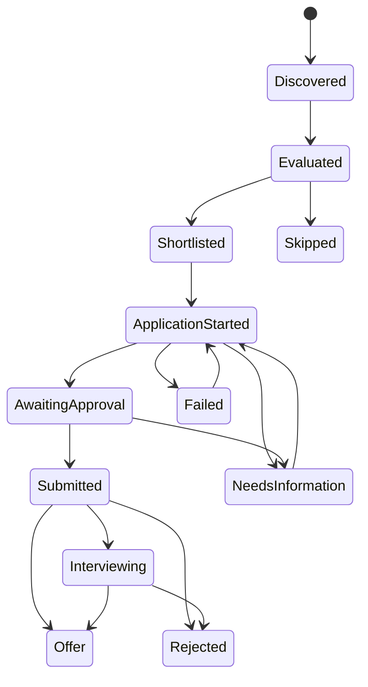

# Staged application automation

See also the per-provider capability register ([JOB_SOURCES](../career-central/design/JOB_SOURCES.md)) and the unified authorization model ([APPROVALS_AND_AUTONOMY](../career-central/design/APPROVALS_AND_AUTONOMY.md)), which existing approval checks will map onto without being weakened.

## Current implementation

Keep the existing provider registry (`providers/_registry.mjs`), transport (`providers/_http.mjs`), scanner (`scan.mjs`), ATS liveness checks (`liveness-api.mjs`), and Playwright installation. No application submission endpoint or submit-click transport has been added. A separately authorized, exact-PDF storage-upload path is available for preparation tests.

The existing scanner writes the broad inbox (`data/pipeline.md`) and scan history. The new collector `scripts/discover-ranked.mjs` reuses Greenhouse, Lever and Ashby provider contracts to retain full descriptions, score evidence and failures. It merges enabled configured employers with private supplemental sources from the application policy. Workday, iCIMS and SmartRecruiters remain available through the existing broad scanner; the structured ranked collector does not yet consume their results. This coverage gap is explicit rather than claiming all platforms are validated end to end.

The collector saves 50 candidates with recognized US locations, with duplicate URL variants removed. Unknown geography is retained in the raw cache for review, never counted as verified US eligibility. A live feed listing is evidence of availability at observation time, not proof every form works. `--verify` reuses individual ATS API checks; expired results are excluded and inconclusive checks remain labeled. Nothing automatically applies, uploads a resume, or generates a tailored resume.

### Operational modes

| Mode | Implemented behavior | Submission |
|---|---|---|
| `discovery` (initial default) | Collect, evaluate, rank, deduplicate and import jobs; inspect public Greenhouse question schemas | Disabled |
| `approval` (current development mode) | Greenhouse schema and live-control inspection, verified text/choice fields, approved PDF/hash, private preparation artifacts and scoped storage upload authorization | No submission transport; future approval must bind to the exact reviewed payload |
| `autonomous` | Configuration and architectural reservation only | Not implemented; toggles cannot enable it |

`data/application-automation/policy.json` is private runtime configuration. It holds score, geography, salary preferences, seniority, employer exclusions, daily/per-run submission limits, approved answer identifiers, approved resume hashes, explicit future autonomous authorization, and kill-switch settings. Submission limits are zero and `submissionEnabled` is false. These settings are not all enforcement code yet: there is no submission runner. Future execution must enforce every condition, not merely read the file.

## Application profile and privacy

`data/application-automation/profile.json` separates personal identity, education, internship experience, technical skills, location/relocation, compensation, work authorization/sponsorship, standard answers, employer-specific answers, and approved resume versions. Verified facts cite the user's supplied resume/preferences. Unknowns are null with `verified: false`; no inferred citizenship, authorization, sponsorship, availability date, full address or attestations. Date precision is preserved (month, not an invented day). `cv.md` remains unchanged.

An approved resume must be an existing file explicitly authorized for upload. Record its SHA-256 in the profile and policy; the browser command verifies the bytes before preparation. This implementation does not generate or approve a PDF automatically. Standard personal fields are mapped by stable ATS schema names. Employer-specific answers require exact board, posting ID and question matching; single-select questions map verified answers to the actual option labels and IDs; native selects and supported custom comboboxes are handled. Unknown/ambiguous choices and unsupported multiselect structures block preparation if required. Optional sensitive demographic questions are not answered automatically. Additional question sections trigger review.

All profile, answers, policies, plans, screenshots, ledger, raw postings and ranked reports live under the existing gitignored `data/` tree, with private directories and restrictive JSON file modes. No real personal data is embedded in code, tests or this document. `.env` and existing user-layer files remain ignored. Browser sessions are ephemeral; credentials/cookies are not saved. Git ignore is accidental-commit protection, not encryption or a backup policy. Do not force-add private runtime files.

## Application history and duplicate prevention

`lib/applications/store.mjs` uses the existing directory lock and atomic rename to update one ledger containing both records and history events. A crash cannot publish a new state without its associated history. Invalid or unreadable data fails closed rather than resetting the ledger.



Exact stored labels include `Application Started`, `Awaiting Approval` and `Needs Information`. The exported transition graph also permits information gathering before shortlisting and bounded recovery from Failed/Skipped. Submitted, Interviewing, Offer and Rejected cannot restart an application.

Canonical posting URLs remove tracking parameters, fragments and `/apply`/`/application` suffixes. Different posting IDs remain distinct. Employer/requisition groups conservatively block a second in-progress attempt and require review; they are NOT used to merge distinct roles or locations. Cross-platform identity resolution is still incomplete. Before any future submission adapter, also reconcile the legacy tracker and candidate portal history; the new ledger alone cannot prove an application was never made outside this system.

A Submitted transition requires confirmation source, reference, HTTPS URL, observation time and approval-plan metadata. The current module validates the shape of supplied evidence; it does not independently authenticate a receipt. No CLI command fabricates or records a successful submission. Future adapters must capture actual ATS confirmation and record the evidence before marking Submitted. Timeouts after a potential submit must enter an ambiguous Needs Information state and reconcile; never blindly retry.

The legacy tracker retains its canonical labels (`Applied`, `Interview`, etc.). The richer ledger does not change the system's shared state vocabulary or UI. A future explicit bridge can map confirmed Submitted → Applied, Interviewing → Interview, Offer → Offer, Rejected → Rejected. No bridge is currently installed, so the two trackers should not be mistaken for synchronized views.

## Platform feasibility and evidence

| Platform | Existing discovery | Application approach and limitations | Validation in this change |
|---|---|---|---|
| Greenhouse | Public boards API provider, descriptions and IDs | Public GET exposes questions; application POST needs employer Basic Auth. Use candidate-facing browser preparation, without trying to obtain employer credentials | Live discovery, schema GET, actual text and custom-dropdown filling on an employer form, plus local browser validation/conditional/file tests. Separate private run report records attachment outcome; submission NOT tested |
| Lever | Public postings provider | Hosted forms/browser adapter; API documentation describes custom-career-site application handling, API-key setup and rate limits. Do not presume an applicant has employer integration access | Live discovery and provider contract tests. Form completion/submission NOT validated |
| Ashby | Public posting feed provider | Separate lightweight feed from authenticated custom-careers integration APIs. Browser adapter needs tenant-specific schema and consent handling | Live discovery. Application completion/submission NOT validated |
| SmartRecruiters | Existing public posting provider | Application API is for customers/partners with authorized access; browser adapter is an alternative subject to form restrictions | Existing provider contract tests only. No live application test |
| iCIMS | Existing career-portal provider | Developer integrations require customer/developer setup; candidate portals differ in login, forms and screening | Existing provider contract tests only. No live application test |
| Workday | Existing tenant-specific public careers provider | Employer recruiting integrations do not imply applicant API permission; reusable browser primitives plus tenant adapters likely needed for accounts, multi-page forms and questionnaires | Existing provider contract tests only. No live application test |
| Other ATS | Existing registry includes many sources | Detect and stop as unsupported until a dedicated adapter passes contract and browser tests | No application support claimed |

Primary references reviewed for feasibility:

- [Greenhouse Job Board API](https://docs.greenhouse.io/job-board)
- [Lever postings API and application notes](https://github.com/lever/postings-api)
- [Ashby custom careers integration](https://developers.ashbyhq.com/docs/creating-a-custom-careers-page)
- [SmartRecruiters Application API](https://developers.smartrecruiters.com/docs/application-api)
- [iCIMS integration setup](https://developer-community.icims.com/getting-started/integrating-icims)
- [Workday recruiting security/setup considerations](https://doc.workday.com/admin-guide/en-us/human-capital-management/recruiting/recruiting-setup/lzi1594032985432.html)

Greenhouse is the first adapter because schema discovery can be tested with public GET requests and existing browser tools. This is not a claim that generic Greenhouse forms are solved.

## Safe browser preparation boundary

`prepare-greenhouse` requires explicit `approval` mode, a recent schema inspection of the exact URL, and a resume approved in both profile and policy. It launches the existing Playwright Chromium, blocks service workers and WebSockets, permits initial HTTPS GET/HEAD requests to Greenhouse and bounded static-resource hosts, then freezes network traffic before entering any values. Autosave, email-validation GETs, analytics and submission writes remain blocked. A separate, explicit, short-lived PDF-only authorization can allow one upload to the exact observed signed storage host: the multipart envelope must contain exactly the approved PDF bytes/hash and only recognized signing, encoding, encryption and opaque CSRF metadata fields. No application-answer fields are permitted. Redirects from the storage request are refused, and the storage HTTP response is captured. This authorization is separate from application-submission approval. This may intentionally break some hosted forms; failure produces a review item rather than relaxing the boundary. It does not click Apply, Next, Submit, or consent controls.

Active security challenges or login fields stop preparation. Passive CAPTCHA widgets are observed and left untouched; the adapter never executes or solves a challenge. Unknown/ambiguous required fields produce Needs Information. A preparation reservation is written under the existing ledger lock before launching a browser. Concurrent workers cannot prepare the same job. Failures record Failed and preserve the attempt artifacts; interrupted attempts require explicit recovery and a dead-owner check. Valid complete preparation produces Awaiting Approval, a private screenshot and plan hash; unknown answers, missing files or unconfirmed uploads produce Needs Information. Browser closure means this is a review artifact, not a resumable submission session. Supporting a persistent approval handoff, validating dynamic form completeness, and submitting after approval are future work.

Kill switch: `node scripts/application-workflow.mjs stop` creates `data/application-automation/STOP`. The environment override is `CAREER_OPS_STOP_SUBMISSIONS=1`. Future submitters must check the persisted switch immediately before transmission and during queued work. No bypass of CAPTCHA, login, security controls, restrictions or consent is permitted.

## Commands and verification

```bash
# Collect public feeds, rank, and check individual ATS liveness:
node scripts/discover-ranked.mjs --verify
# Re-score cached feeds and re-check availability without collecting every board:
node scripts/discover-ranked.mjs --rerank --verify
# Import discoveries as Evaluated; this does not mark them applied:
node scripts/application-workflow.mjs import-discovery
# Read public application schema; writes a private plan but sends no personal data:
node scripts/application-workflow.mjs inspect-greenhouse --url https://job-boards.greenhouse.io/BOARD/jobs/ID
# Gated preparation; currently blocked in discovery mode:
node scripts/application-workflow.mjs prepare-greenhouse --url https://job-boards.greenhouse.io/BOARD/jobs/ID
# Stop queued automation (no active submit transport exists):
node scripts/application-workflow.mjs stop
# Meaningful fixture/concurrency/guard tests:
node --test tests/application-automation.test.mjs
```

The first ranking is a transparent heuristic, not a statistically validated probability: base fit, early-career title, graduation-year mention, bounded resume-skill overlap, primary role-family alignment, geographic preferences, stated experience and posting recency, with deductions for unknown description/location, internship priority and experience gaps. Requirements are keyword-extracted excerpts, not an exhaustive semantic interpretation. A graduation-year mention does not prove the exact graduation window or start date matches. Scores cap at 95 and all recommendations still require eligibility review. Search-emphasis proportions are stored preferences, not hard quotas or qualification-score multipliers. No salary rejection is applied. Graduate-degree-specific titles and known senior/foreign listings are excluded. Unknown titles/locations and complex alternative degree/experience requirements still need review. Full semantic scoring and a labeled benchmark are prerequisites for autonomous thresholds.

## Incremental roadmap and release gates

1. **Discovery baseline (this increment):** live provider reuse, raw evidence, source failures, provisional top 50, location holds, liveness evidence and private ledger. Next improve DFW/enterprise coverage, consume all broad-scanner providers in the ranked path, classify alternative requirements, and add cross-platform duplicate review.
2. **Application profile readiness:** confirm missing eligibility fields and precise availability; explicitly approve an existing upload-ready resume/hash, standard answer library and consent choices. Add answer provenance, expiry and revision history. No automatic resume edits.
3. **Greenhouse approval workflow:** extend text/choice/upload schema coverage; test dynamic forms, error messages, consent and resume bytes with fixtures and a controlled sandbox. Build a concrete approval UI tied to immutable job, question schema, payload and resume hashes. Recheck availability at preparation and submit time. Prove that modified or expired plans invalidate approval.
4. **Confirmation and idempotency:** sandbox-only submission adapter, durable attempt reservation, payload-bound approval, daily limits, kill-switch checks immediately before send, confirmation extraction, ambiguous-timeout reconciliation, legacy-tracker sync, and duplicate tests across concurrent workers. A request succeeding is not confirmation.
5. **Additional platforms:** Lever/Ashby adapters first when fixtures and permitted tenant flows are available; then SmartRecruiters, iCIMS and Workday. Publish separate inspected/fixture-tested/live-prepared/sandbox-submitted capability levels, not a single supported boolean.
6. **Autonomous pilot:** only after the user separately enables the mode and authorizes a versioned rule set. Require verified eligibility, validated minimum score, approved resume and answers, geographic/seniority/employer restrictions, rate limits, zero unknown mandatory answers, reliable confirmation and retry discipline. Begin with a tiny daily limit and a narrowly validated adapter. Stop on any uncertainty, challenge or restriction. Revoke authorization whenever rules, resume or answers change materially.

No real applications were submitted during implementation. Enabling autonomous mode is not part of this increment.


## Incremental validation update

Application eligibility mapping now uses explicit verified profile records, preserves false-valued sponsorship answers, and rejects negated, compound, foreign-country, clearance and export-control questions rather than extrapolating citizenship. Preferred name and explicitly provided pronouns may be reused; employer-specific discovery-source and employment-history answers remain scoped to the exact board and posting.

A live application preparation test is distinct from a submission test. The current adapter inspects all initial inputs/selects/textareas, label-based required markers, native constraints, visible error messages, and newly revealed required fields. Stable IDs supplement name-based lookup because modern Greenhouse inputs often omit names. Selected custom-dropdown display values are checked rather than treating the empty internal search input as an unanswered question. Required controls outside the public schema remain review items. The selected live form does not ask for separate education/employment-history fields: those facts are checked against the approved PDF and structured profile, not claimed as live-filled fields.

The same original 50-job shortlist can be reevaluated with `node scripts/reevaluate-shortlist.mjs`. Description-specific reviews live privately, carry the description hash, and are invalidated if the source text changes. The script reuses the existing scorer and liveness checker and updates existing ledger identities only; it refuses to create missing records. Every evaluation refresh has a history event. A geographic regression test covers Ontario's `CA` country code being confused with California. The 40/40/20 search emphasis remains a preference, not a forced shortlist quota or qualification-score multiplier.

Additional tests:

```bash
node --test tests/application-automation.test.mjs tests/application-greenhouse-workflow.test.mjs tests/application-upload-policy.test.mjs tests/application-pilot.test.mjs
```

This suite covers authorization scope, exact dropdown option values, unknown answers, native checkboxes/selects/files, conditional required fields, displayed errors, plan hashes/freshness, concurrent reservations, dead-worker recovery and the PDF-only network boundary. Local fixture checks do not imply every employer's controls work. Employer-side validation, persistent review sessions, post-review submission, actual confirmation capture and autonomous submission remain unvalidated or unimplemented.

## Limited pilot preparation

`scripts/prepare-application-pilot.mjs` produces a private readiness manifest only; it never enables submission. The pilot requires a maximum of five applications, a minimum 85/100 score, Greenhouse, US engineering roles, the exact approved resume hash, confirmed graduation/start compatibility, complete verified employer answers, no external application-history uncertainty, and a validated submission/confirmation process. Separate authorization must bind the application cap, resume hash, start month and policy hash; the user's preparation request alone is insufficient. Invalid caps or weaker thresholds are rejected. No executable autonomous submission adapter has been added.

The corrected upload boundary passes legitimate page-generated CSRF metadata unchanged, enforces signed S3 policy expiration/bucket/field conditions, refuses duplicate fields and non-file application answers, and checks the approved PDF hash and byte length. Native browser transmission preserves the platform's security and upload/progress behavior; no CSRF token is invented, removed or solved. A live-envelope audit checks the legitimate request and aborts it before transmission. A live storage response plus the visible attached filename are both needed to claim an attachment succeeded.

## First reviewed submission handoff

`scripts/review-first-application.mjs --job-key KEY` refreshes an existing job and profile, reserves a preparation, keeps the fresh browser alive, and writes a private immutable review. It does not submit on launch. A separate `approve-one` control message must bind the exact job key, review hash, one-use nonce and cap of one application. Profile/PDF/schema changes and expiry invalidate approval. Autonomous mode stays disabled.

After explicit user approval, the one-application flow briefly arms manual submission under the existing kill-switch and STOP-file checks. It clicks the native form's exact Submit application control; it does not construct or post an application through a separate API. A route guard verifies identity, custom question answers and the uploaded resume reference against the approved review before permitting the single published native request. Native CSRF, fingerprint and security assessment fields pass unchanged. Unsupported payloads, active challenges and unexpected destinations stop the run.

The request reservation and dispatch are persisted before transmission. A native accepted response alone is insufficient: the exact published confirmation page and confirmation text must also be observed. The text, screenshot, hash and receipt JSON are stored privately before recording Submitted. An ambiguous interruption blocks retries. A recorded receipt can repair an interrupted ledger update without sending another application. Confirmed submissions mirror idempotently to the legacy Applied tracker using the shared tracker transaction; replaying that mirror is the safe recovery check. None of this enables an unattended five-application pilot.

## Outlook application communications

`scripts/outlook-email.mjs` adds personal Microsoft account access via delegated Graph Mail.Read and the official MSAL library. See [connection instructions](../OUTLOOK.md). OAuth cache files are required to be outside Git with owner-only access. The adapter exposes only GET message list/detail calls; no mailbox mutation, code-entry or application-submit transport exists. It uses the resolved data root and existing ledger locking for account-scoped message deduplication and minimal review-only observations. Confirmation/interview/assessment/recruiter updates are evidence proposals, not automatic application-state changes. Sender authenticity and real templates require live validation before scoped code-use authorization. The prior verification-required application remains blocked; email setup cannot clear its retry gate or change submission policy.
